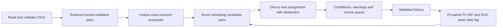
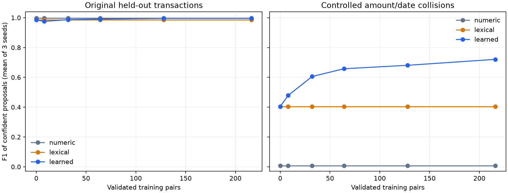

# Financial reconciliation with learned transaction representations

**Kritika Gautam — AI Engineer assignment**

Match bank transactions to internal register entries despite different descriptions,
posting delays and small amount differences. Human-reviewed pairs teach a shared
latent text representation, and a global assignment prevents duplicate matches.

This is a Python CLI implementation of the AI Engineer reconciliation assignment.
It runs locally without API keys, a GPU, or downloaded language-model weights.

## Quick start

Python 3.10 or newer is required. From this repository's root:

```bash
python3 -m venv .venv
source .venv/bin/activate
python -m pip install -e ".[dev]"
python -m pytest -q
python -m recon match --output runs/initial
```

On Windows, activate with `.venv\Scripts\activate`. Installing dependencies needs
internet access; matching and evaluation run offline afterward.

For the exact tested dependency versions, use Python 3.12 or newer and install `requirements-lock.txt` before
installing this package: `python -m pip install -r requirements-lock.txt` followed
by `python -m pip install --no-deps -e .`.

The matcher writes:

- `matches.csv`: a row for every bank transaction, its proposed counterpart,
  confidence score, status, evidence, warnings, and alternative register IDs.
- `review.csv`: the same evidence with editable review fields.
- `unmatched_register.csv`: register rows without an assigned bank counterpart.
- `summary.json`: counts, model state and output locations.

The default input files are `data/bank_statements.csv` and `data/check_register.csv`.
Use `--bank`, `--register`, `--state`, and `--output` to select other paths.
Amounts must be nonnegative with at most two decimal places; direction is represented
by `DEBIT/CREDIT` or `DR/CR`. Dates must use `YYYY-MM-DD`.

## Match → review → improve

1. Run the initial match command above.
2. Copy `runs/initial/review.csv` to `runs/reviewed.csv`. Inspect the proposed pairs
   and edit the following fields. Leave unrelated cells and metadata unchanged.

   | Decision | What to enter | Effect |
   |---|---|---|
   | Accept | `decision=accept` | Confirm the displayed pair |
   | Reject | `decision=reject` | Ban that pair from future proposals |
   | Correct | `decision=correct`, `corrected_register_id=<actual ID>` | Replace the proposed match; also works for unmatched rows |
   | Defer | Leave `decision` blank | Make no change |

   `comment` is optional and is retained in the audit history. Read identifiers as
   text if using spreadsheet software. A high score is not a substitute for checking
   warnings; the fixture contains a conflicting check number, for example.

3. Import the review, then refit and rematch:

   ```bash
   python -m recon review --file runs/reviewed.csv
   python -m recon match --output runs/after_review
   ```

Only accepted or corrected pairs train the model. The first run has zero training
pairs and uses a lexical fallback for text. Three reviewed pairs are the minimum
for fitting SVD; more varied history is needed for useful generalization.

Validated pairs remain reserved. Rejected pairs cannot reappear. A whole review batch
is validated before it is saved, including one-to-one checks. Correcting two swapped
pairs is supported in a single batch. Review queues carry a dataset fingerprint and
state revision; stale queues must be regenerated. State is saved as readable JSON,
not an executable pickle. Use one process per state file.

### Reproducible simulated review demo

```bash
python scripts/demo.py --truth data/reference_inferred.csv
```

The script runs the actual CLI workflow, simulates review of the 286 unique-amount
pairs using the explicit reference, and rematches the remaining 22 records. It writes
before/after outputs and `demo_summary.json` under `runs/demo/`. For another run,
choose a fresh directory with `--output runs/demo2`.

**These are simulated reviews, not approvals by a person.** The human workflow above
does not need any reference labels.

## Approach



**Unique-amount stage.** Amounts are stored as integer cents and counted across each
complete input before reviewed rows are removed. A matching amount occurring once
in each source, with compatible direction, produces a seed proposal. Unexpected
date gaps or conflicting check references require review. Predicted seeds do not
automatically become training examples.

**Learned text stage.** A reviewed pair becomes a combined document with separate
bank and register vocabularies. For example, a pair can contain `b__bp`, `b__gas`,
`r__fill`, and `r__up`. TF-IDF weights these tokens and word bigrams; truncated SVD
finds shared latent factors. New bank and register records project separately into
the same space and are compared using cosine similarity. Register category and notes
are included as descriptors; balance and transaction IDs are excluded. Arbitrary
numeric tokens are removed from text; check references have an explicit comparison.

Learned text similarity is 85% latent cosine and 15% character TF-IDF cosine.
With insufficient training, or when either description has no usable learned
representation, the full character TF-IDF similarity is used instead. Date-lag location and
spread are estimated from reviewed pairs using the median and median absolute
deviation. See [DESIGN.md](DESIGN.md) for the exact scoring equations and thresholds.

**Assignment.** Remaining candidates must have the same direction, an amount
difference of at most 10 cents, and an absolute date gap of at most 45 days.
These defaults are configurable in the CLI. A Hungarian assignment maximizes total
score above an abstention floor, with dummy columns allowing unmatched rows.
Low scores, weak separation from alternatives, and material warnings trigger review.

**Learning terminology.** SVD is an unsupervised factorization, but its paired corpus
is built from human-validated examples. The overall workflow uses weak initial
evidence and human supervision; it is not learning without any correspondence
information. This matches the assignment's requested feedback cycle.

## Evaluation and measured results

```bash
python -m recon evaluate --truth data/reference_inferred.csv --output reports
```

The checked-in [analysis report](reports/ANALYSIS.md), raw metric CSVs, error cases,
predictions, and plot are reproducible with that command.

**Reference limitation:** the supplied files have matching `Bxxxx`/`Rxxxx` suffixes.
`scripts/infer_reference.py` explicitly constructs a provisional pairing from that
convention and verifies compatible types, 0–5 day lags and amount differences ≤5
cents. This is **not independently verified ground truth**. The matcher never parses
IDs or reads this reference. All reported accuracy is conditional on the inferred
mapping; confirm the convention with the dataset author before treating it as a gold
benchmark. See [data provenance](data/README.md).

Metrics count confident machine proposals before review. Review-required and
unmatched rows reduce recall. Training pairs are excluded from holdout and
remaining-row metrics. Precision is defined as zero when no confident matches exist.

| Evaluation | Precision | Recall | F1 |
|---|---:|---:|---:|
| Unique amounts only, all 308 rows | 100.0% | 92.5% | 96.1% |
| Amount/date baseline, all 308 rows | 100.0% | 99.7% | 99.8% |
| Cold hybrid, all 308 rows | 100.0% | 97.7% | 98.9% |
| Cold hybrid, 22 remaining rows | 100.0% | 72.7% | 84.2% |
| Hybrid after seed review, same 22 rows | 100.0% | 90.9% | 95.2% |

There are 286 unique-amount proposals but only 285 confident ones: one has a
conflicting check reference and is deliberately sent for review. After simulated
seed review, the model confidently proposes 20 of the 22 remaining pairs, up from
16. Two remain below the confidence threshold.

**The numeric baseline is stronger on the original fixture.** Its amounts and dates
already identify nearly all pairs. The project does not claim an ML advantage on
that easy dataset.

To isolate the value of learning, evaluation uses three fixed 70/30 splits and a
controlled collision fixture constructed only from the held-out rows. Groups of
up to four same-direction transactions are given identical amounts and dates while
retaining their original descriptions. IDs and row ordering are randomized. This is
an explicit stress test, not additional naturally observed financial data.

On that collision test, mean F1 increases from **40.5% with no reviewed pairs to
72.1% with 216 training pairs**; the latter has **99.5% mean precision and 56.9% mean
recall** across three seeds. With eight training pairs, mean stress-test F1 is 47.9%;
with 32 pairs it is 60.6%. Sparse training can still reduce performance on the original
holdout, so the full curves, sample standard deviations, baselines and errors are
reported for both datasets.



## Trade-offs and limitations

- This adapts the paper's paired cross-language representation and review loop.
  It omits explicit mutual-information term alignment and uses paired TF-IDF/SVD
  directly. The assignment allows such departures; this reduces implementation
  complexity but may miss useful fine-grained alignments.
- Pretrained language embeddings could improve cold-start semantics, but do not
  automatically learn from feedback. The local SVD implementation makes that
  adaptation explicit with modest dependencies and an inspectable training corpus.
- Scores are evidence rankings, **not calibrated probabilities**. The weights and
  thresholds are fixed engineering defaults, not fitted to the evaluation holdout.
- Similar groceries, transfers or generic subscription descriptions remain hard
  when amount/date evidence is removed. No algorithm can reliably recover identity
  when all available fields are indistinguishable. The stress test includes one
  incorrect confident grocery match at maximum training size.
- Amount/date candidate limits can exclude genuine anomalies. Only one-to-one,
  single-currency reconciliation is supported. Account identifiers, foreign exchange,
  fees, splits, merged settlements and signed-amount ingestion need extensions.
- The current state is intentionally bound to one dataset. Production history needs
  dataset-scoped IDs and a persistent review store. Concurrent writers are not
  supported. Random holdout does not test future-time drift.
- Candidate scoring is dense and the assignment is cubic in matrix dimension in the
  worst case. At 308×308 this is small; production scale needs indexed candidate
  generation and independent assignment within connected candidate groups.

With more time: independently verified labels, temporal evaluation, calibrated
confidence, domain embeddings compared against this baseline, active review
selection, multi-account/currency support, and batch-aware historical learning.

## Project layout

```text
recon/data.py          CSV validation, exact money, transaction representation
recon/model.py         Paired TF-IDF/SVD and lexical fallback
recon/engine.py        Candidate scoring, confidence and global assignment
recon/review.py        Validated history, rejection handling and atomic review
recon/cli.py           Match, review and evaluate commands
recon/evaluation.py    Baselines, held-out learning curves, stress data and reports
scripts/demo.py       Full CLI cycle with explicitly simulated reviews
scripts/infer_reference.py  Provisional fixture-label construction only
tests/                Data, matching, review, learning and CLI integration tests
reports/              Measured results and inspectable prediction/error records
```

Reference: Peter A. Chew (2020), *Unsupervised-Learning Financial Reconciliation:
a Robust, Accurate Approach Inspired by Machine Translation*, ICAIF ’20.
DOI: [10.1145/3383455.3422517](https://doi.org/10.1145/3383455.3422517).

